# MDW Wellness: Office SOP (Admin and Executive)

This guide shows how to do the office work in the MDW Wellness dashboard. Each part is one task.

- **Website:** https://dashboard.wellness.mydawaiwala.com
- **For:** Admins and Executives. A task marked **Admin only** does not work from an Executive login.
- **Screenshots** are from a computer. The customer names, phone numbers and emails in them are not real.
- **Enquiry and lead mean the same thing** in this guide and in the app: a customer who contacted us.

## How to read this guide

- **Red circles with letters (A, B, C)** show a place on the screen. Below each picture, (A), (B) and so on tell you what that place is.
- **Numbers (1, 2, 3)** are the steps. Do them in order. A step shows its place with a letter. Example: "Click **Record payment** (C)."
- Inside an enquiry, the app also has numbered steps (1. Lead info, 2. Executive reach-out, and so on). In this guide we write their names, not their numbers. Example: "the **Payment** step".

## Tasks

| # | Task | Admin | Executive |
|---|---|---|---|
| **A. Getting started** | | | |
| 1 | Log in, log out, reset a forgotten password *(coming)* | ✓ | ✓ |
| 2 | Update your own profile *(coming)* | ✓ | ✓ |
| **B. Enquiries** | | | |
| 3 | [Add a new enquiry](#3-add-a-new-enquiry) | ✓ | ✓ |
| 4 | [Call the customer, and call again later (follow-ups)](#4-call-the-customer-and-call-again-later-follow-ups) | ✓ | ✓ |
| 5 | [Confirm what the customer wants](#5-confirm-what-the-customer-wants) | ✓ | ✓ |
| 6 | [Send a payment link](#6-send-a-payment-link) | ✓ | ✓ |
| 7 | [Record a payment](#7-record-a-payment) | ✓ | ✓ |
| 8 | [Assign a therapist](#8-assign-a-therapist) | ✓ | ✓ |
| 9 | [Send the visit code](#9-send-the-visit-code) | ✓ | ✓ |
| 10 | [Cancel an enquiry or change its status](#10-cancel-an-enquiry-or-change-its-status) | ✓ | only your own enquiries |
| 11 | [Give an enquiry to another person](#11-give-an-enquiry-to-another-person) | ✓ | ✗ |
| 12 | [Delete an enquiry](#12-delete-an-enquiry) | ✓ | ✓ |
| **C. Bookings (Book Slot)** | | | |
| 13 | [Book an appointment directly](#13-book-an-appointment-directly) | ✓ | ✓ |
| 14 | [Change a booking's date or therapist](#14-change-a-bookings-date-or-therapist) | ✓ | ✓ (with a reason) |
| 15 | [Cancel a booking](#15-cancel-a-booking) | ✓ | ✓ |
| 16 | [Billing: ask for payment, offers, add-ons, invoice](#16-billing-ask-for-payment-offers-add-ons-invoice) | ✓ | ✓ |
| 17 | [Complete a visit when the therapist could not](#17-complete-a-visit-when-the-therapist-could-not) | ✓ | ✗ |
| **D. Customers** *(coming)* | | | |
| 18 | Find a customer, add a note, book again | ✓ | ✓ |
| 19 | Stop or allow cash (COD) for a customer | ✓ | ✓ |
| **E. Money** *(coming)* | | | |
| 20 | Invoices: download, add, edit, cancel (void) | ✓ | ✓ |
| 21 | Earnings, and paying therapists | ✓ | earnings only |
| **F. Setup** *(coming)* | | | |
| 22 | Services, prices and session rates | ✓ | ✓ |
| 23 | Add, edit or stop a therapist, and set their earnings share | ✓ | not the earnings share |
| 24 | Therapist leave and off days | ✓ | ✓ |
| 25 | Office users and the booking gap | ✓ | ✗ |
| **G. Reports** *(coming)* | | | |
| 26 | Dashboard and Analytics | ✓ | ✓ (without payout numbers) |

---

## The stages of an enquiry

You see the stage in the **Stage** column, and at the top of the enquiry.

| Stage | What it means |
|---|---|
| **Enquiry** | New. Nobody has called yet. It shows under **Needs first contact**. |
| **Follow-up** | Someone called, but the customer did not answer. It shows on the **Follow-ups** page. |
| **Reached out** | Someone has talked to the customer. |
| **Booked** | The customer agreed to an online consultation or a home visit. |
| **Paid** | A payment is recorded. |
| **Assigned** | A therapist, date and time are set. It also shows on **Book Slot** now. |
| **Completed** | The visit is done. |
| **Cancelled** | Cancelled, with a reason. |

---

## 3. Add a new enquiry

**When:** a customer calls, sends a message or comes to the office.

Open the menu. Click **Enquiries**.

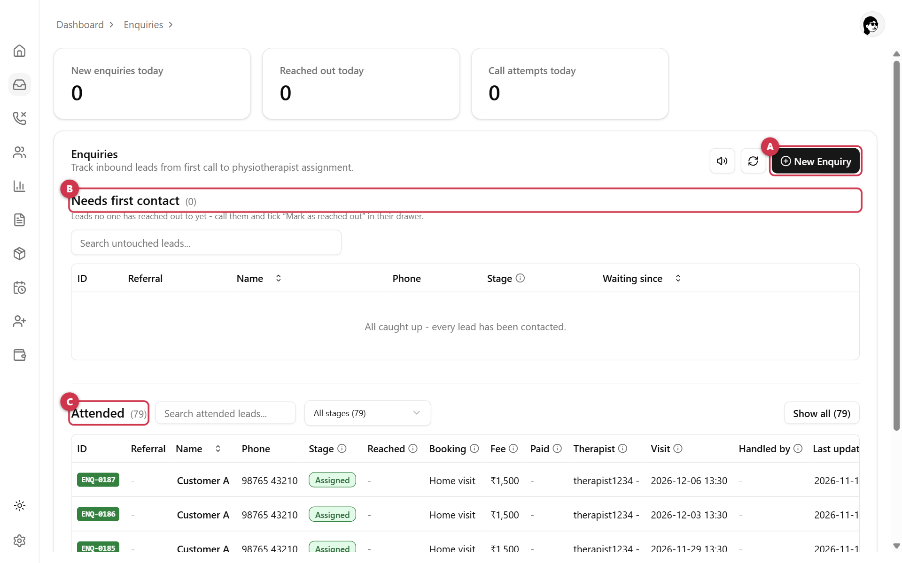

- **(A) New Enquiry:** adds a new enquiry.
- **(B) Needs first contact:** new enquiries. Nobody has called them yet. Start your day here.
- **(C) Attended:** enquiries where someone already talked to the customer. To see only one stage, use **All stages** next to it. Example: select **Booked**.

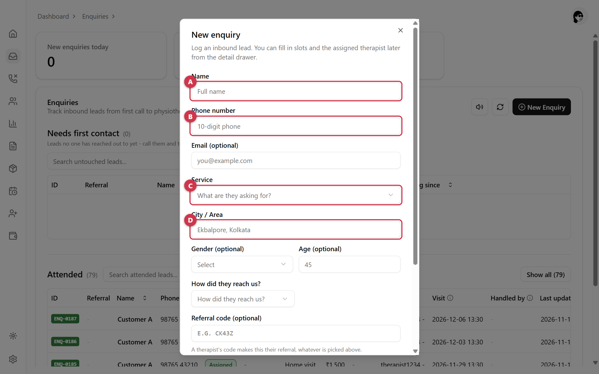

1. Click **New Enquiry**.
2. Fill the **Name** (A) and the 10-digit **Phone number** (B).
3. Select the **Service** (C): Online Consultation, Home Therapy or Vitals Check.
4. Fill **City / Area** (D). It is needed for a home service.

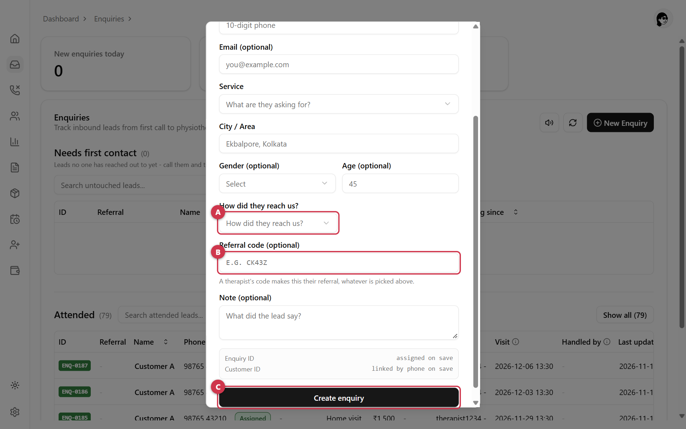

5. Select **How did they reach us?** (A): Online, WhatsApp, Walk-in or Via Therapist. For Via Therapist, also select the therapist.
6. If the customer has a therapist's referral code, type it (B).
7. Click **Create enquiry** (C). You see "Enquiry created". The enquiry shows under **Needs first contact**.

Good to know:

- If this phone number already has an open enquiry, you see a warning. You can still add the new one.

### If something is not right

| Message | What to do |
|---|---|
| "Phone must be exactly 10 digits" | Type the number without +91 and without spaces. |
| "City / area is needed for a home service" | Fill City / Area. |
| "Pick how this booking reached us." | Select an option in How did they reach us. |
| "Pick the therapist who referred them." | You selected Via Therapist. Select the therapist. |
| "That referral code doesn't match an active therapist." | Check the code with the customer, or keep it empty. |

---

## 4. Call the customer, and call again later (follow-ups)

**When:** as soon as a new enquiry comes.

1. Under **Needs first contact**, click the enquiry's row. Its details open on the right side.
2. Call the customer.

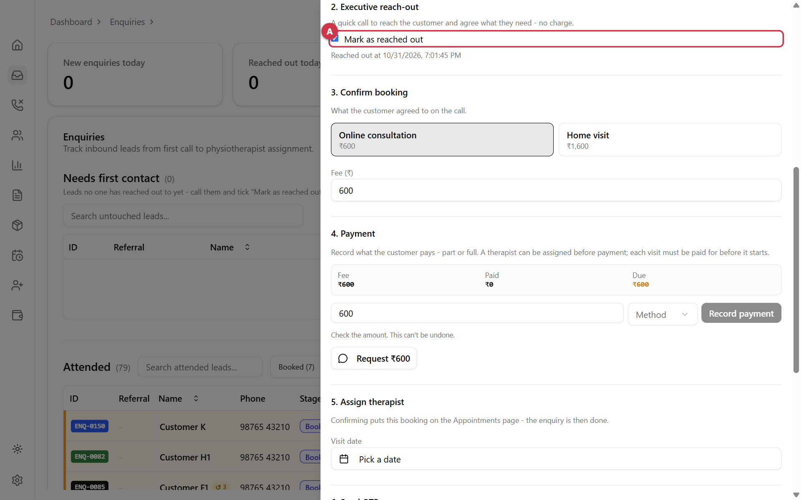

3. **The customer answered:** tick **Mark as reached out** (A). It saves at once. This enquiry is now yours ("Handled by" shows your name).
4. **No answer:** click **Couldn't connect (no answer)** in the same place. This button shows only until someone talks to the customer. The enquiry moves to **Follow-ups**.

### Call again (follow-ups)

Open the menu. Click **Follow-ups**.

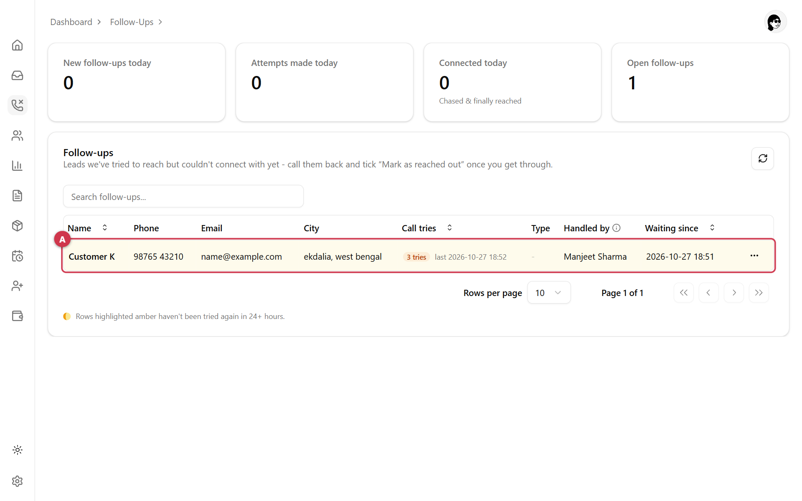

- **(A)** An enquiry to call again. **Call tries** shows how many times we called, and the last time. A yellow row means nobody called in the last 24 hours.

1. Click the row. Call the customer again.
2. When the customer answers, tick **Mark as reached out**. The enquiry leaves the Follow-ups page.

Good to know:

- An enquiry belongs to the person who first ticked Mark as reached out. If an Executive changes another person's enquiry, the app asks for a reason ("Editing X's lead"). Type the reason. Click **Save with reason**. Admins are not asked.

---

## 5. Confirm what the customer wants

**When:** on the call, after the customer agrees.

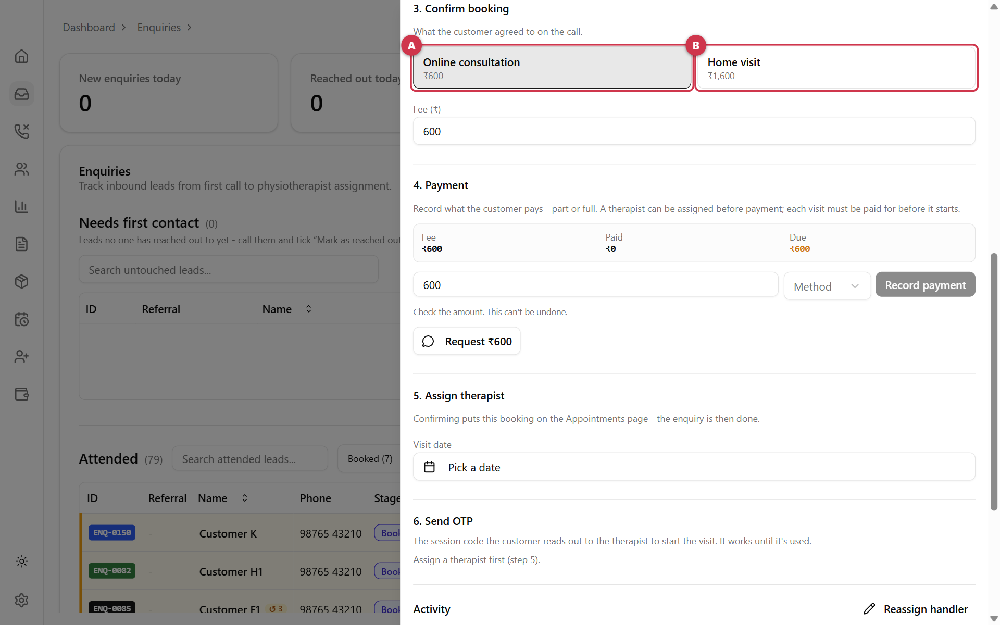

1. In the **Confirm booking** step, click what the customer wants: **Online consultation** (A) or **Home visit** (B). Each shows its price.
2. It saves at once. The fee comes from the **Services** page. The stage becomes **Booked**.

---

## 6. Send a payment link

**When:** the customer wants to pay online before the visit.

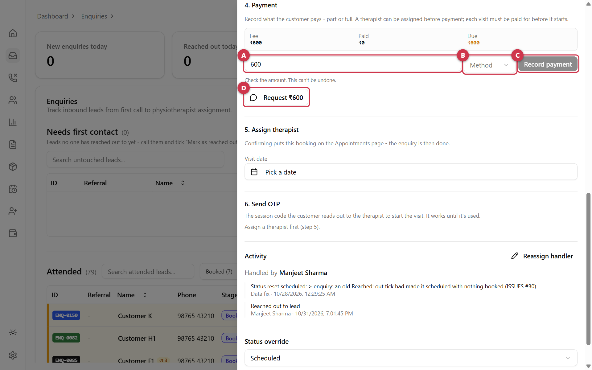

The **Payment** step shows the fee, the paid amount and the due amount.

- **(A) Amount**
- **(B) Method:** Cash, UPI, Card, Bank or Other.
- **(C) Record payment**
- **(D) Request ₹600:** sends the customer a payment link.

1. Click **Request ₹X** (D). WhatsApp opens with a message and a payment link for the due amount.
2. Press send in WhatsApp.
3. **A payment made with the link is not recorded by itself.** When you see the money has come, record it (task 7).

### If something is not right

| Message | What to do |
|---|---|
| "Confirm the booking type and fee first" | Do task 5 first. |
| "This lead has no usable phone number" | Correct the phone number in the Lead info step (click **Edit**). |
| "Couldn't create the payment link" | Try again after a minute. If it still fails, tell an Admin. |

---

## 7. Record a payment

**When:** the customer has paid, in any method, part or full.

Use the same **Payment** step as in task 6.

1. Check the amount (A). It shows the due amount. For a part payment, change it.
2. Select the payment method (B).
3. Click **Record payment** (C). **You cannot undo this.** Check the amount first.
4. To send the customer a WhatsApp message that the payment is received, click **Send confirmation**. This button shows after a payment is recorded.

### If something is not right

| Message | What to do |
|---|---|
| "Only ₹X is due on this booking." | You entered more than the due amount. Enter the correct amount. |
| "This booking has no price yet." | Do task 5 first. |
| "Another payment was just recorded - refresh and try again." | Someone else recorded a payment at the same time. Close the enquiry. Open it again and check the due amount. |
| "This customer is COD blacklisted: take UPI, card or a payment link, not cash." | Cash is stopped for this customer. Take another method. |

---

## 8. Assign a therapist

**When:** the customer has agreed a day. You can assign before payment. But each visit must be paid before it starts.

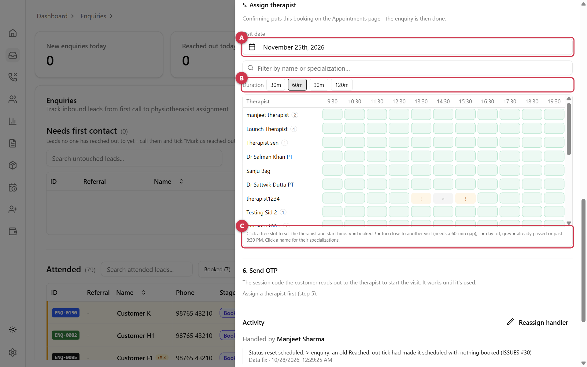

1. In the **Assign therapist** step, click **Pick a date**. Select the day (A).
2. Select the visit length (B): 30, 60, 90 or 120 minutes.
3. Find the therapist's row. Click a free green box. The line below the table (C) explains the marks: × is booked, ! is too close to another visit, - is an off day, grey is past time or after 8:30 PM.
4. Click **Confirm assignment**. The stage becomes **Assigned**. The booking now also shows on **Book Slot**.

To change it later: click **Change** in the same step. Select the new time. Click **Yes, move it**. Executives must also select a reason.

### If something is not right

| Message | What to do |
|---|---|
| "Set the booking fee in step 3 - without it no invoice is raised." | Do task 5 first. |
| "... leaves less than the 60-min gap to .... Pick another time." | Select a time further from this therapist's other visit. |
| "... is off on ..." or "... is on leave from ... Pick a different date or therapist." | The therapist is not working that day. Select another day or another therapist. |
| "Pick a reason for the reassignment" | Executives: select a reason. Then click Yes, move it. |

---

## 9. Send the visit code

**When:** before the visit, after a therapist is assigned. The therapist needs this code to start the session.

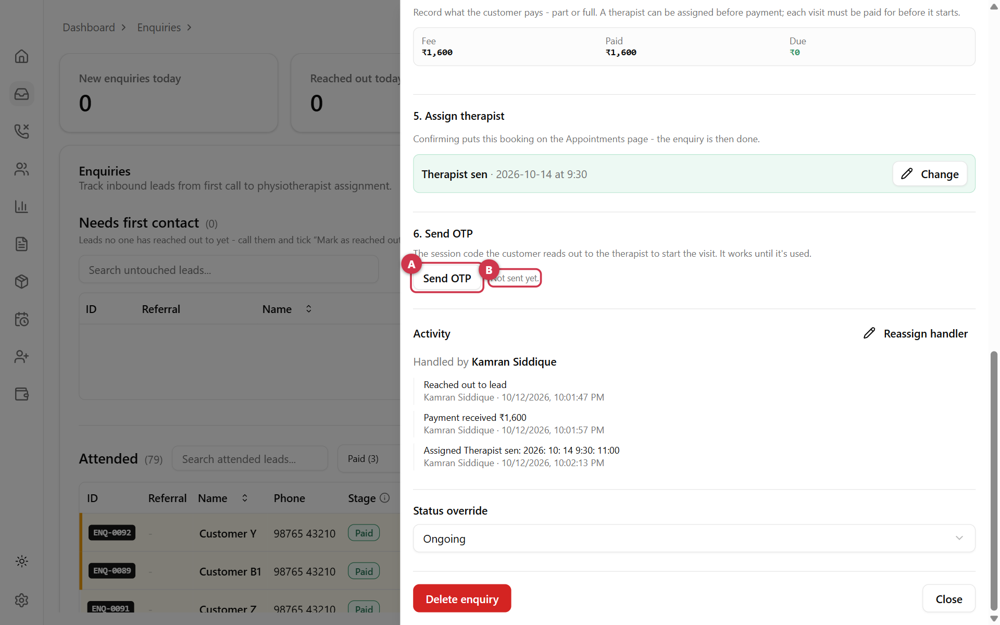

1. In the **Send OTP** step, click **Send OTP** (A). WhatsApp opens with "Your MDW visit code is ####".
2. Press send in WhatsApp. The text next to the button (B) changes from "Not sent yet." to the time and the sender's name.

Good to know:

- The code has no time limit. Send it again only if the customer lost it.
- For a course, each session needs its own code.
- At the home, the customer reads the code to the therapist. The therapist types it.

---

## 10. Cancel an enquiry or change its status

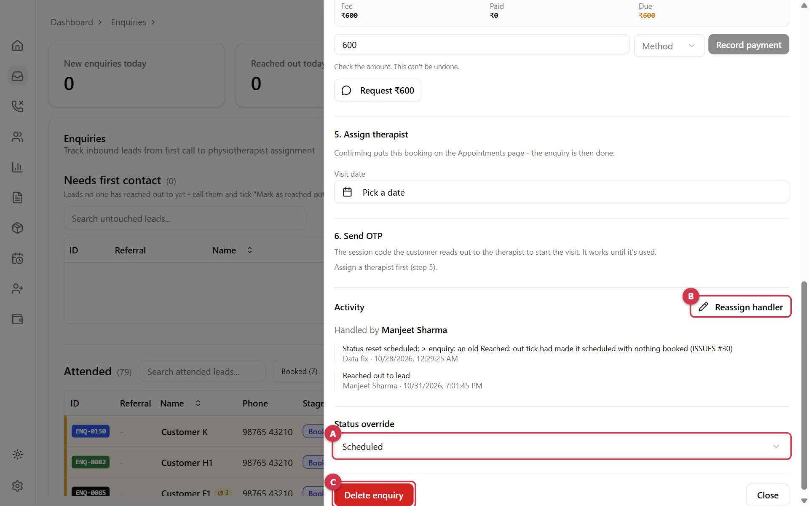

- **(A) Status override:** changes the status by hand.
- **(B) Reassign handler:** **Admin only** (task 11).
- **(C) Delete enquiry:** task 12.

1. At the bottom of the enquiry, select the new status in (A). Example: **Cancelled**.
2. For Cancelled, write the reason in **Reason for cancellation**.
3. Click **Apply change**.

Good to know:

- Executives can change the status only on their own enquiries. On other enquiries you see "Only admins or X can change status." Ask an Admin, or ask that person.

---

## 11. Give an enquiry to another person

**Admin only.** Use this when the person handling the enquiry is on leave, or has too much work.

1. Open the enquiry. Click **Reassign handler** (B in task 10).
2. Select the person. It saves at once. The Activity list shows the change.

---

## 12. Delete an enquiry

**When:** only for an enquiry that is a mistake. Example: added twice, or a test. If a real customer does not want the service, cancel it instead (task 10).

1. Open the enquiry. Click **Delete enquiry** (C in task 10).
2. The app asks "Delete enquiry?". Click **Delete**.

**A deleted enquiry cannot be brought back.**

(After deleting, the message says "Appointment cancelled". This is wrong text: the enquiry is deleted.)

---

## 13. Book an appointment directly

**When:** the customer already knows what they want, and you want to book the therapist now. For a new customer who is only asking questions, add an enquiry instead (task 3).

Open the menu. Click **Book Slot**. The page name is **Appointments**.

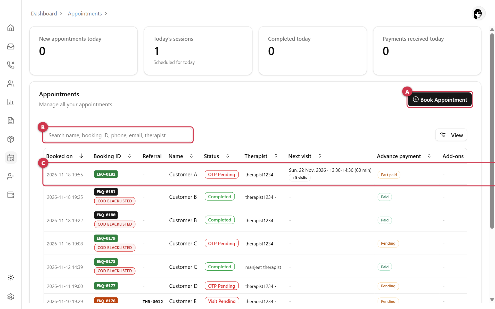

- **(A) Book Appointment:** books a new appointment.
- **(B) Search:** find a booking by customer name, booking ID, phone, email or therapist.
- **(C)** A booking. Click the row to open it (tasks 14 to 17).

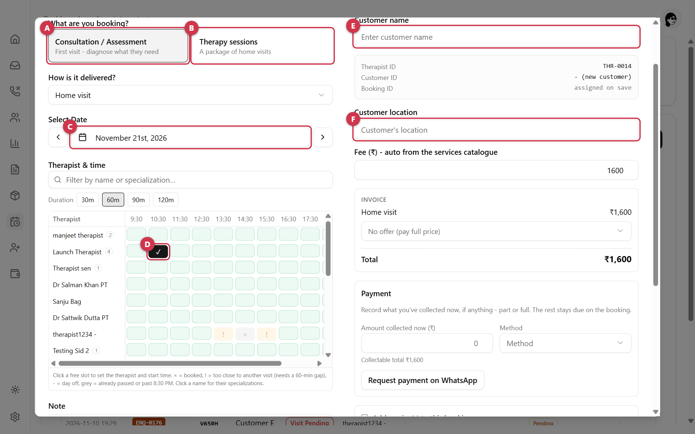

1. Click **Book Appointment**.
2. Select what you are booking: **Consultation / Assessment** (A) for a first visit, or **Therapy sessions** (B) for a package of home visits.
3. Check **How is it delivered?**: Home visit or Online consultation.
4. Select the date (C). Use the arrows for the day before or after.
5. Select the visit length (30m, 60m, 90m, 120m). Then click a free green box in the therapist's row (D). It shows a tick.
6. Type the **Customer name** (E). If the customer is already with us, select them from the list. Their details fill in by themselves.
7. Fill the **Customer location** (F) for a home visit.

For **Therapy sessions**, also fill **Number of sessions** and **How often** (once to four times a week). The app shows the dates it will book. If this customer never had a consultation with us, write why (example: "existing patient, treated with us since March").

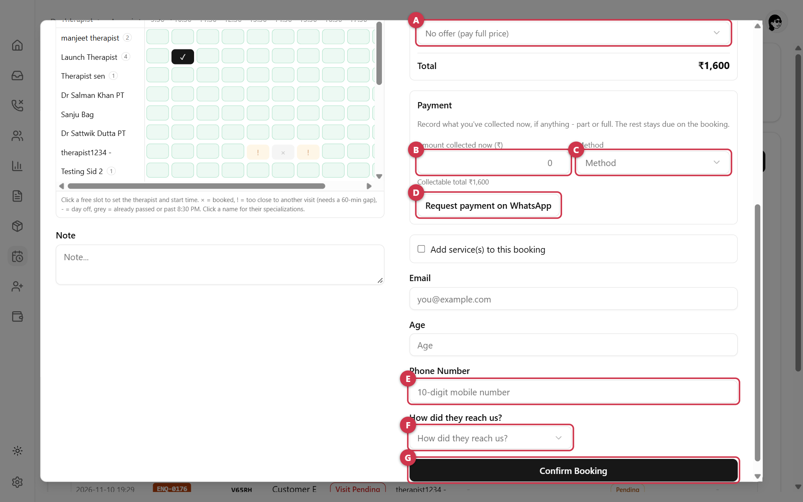

8. The fee comes from the Services page. To give an offer, select it in (A). The **Total** changes.
9. If the customer paid now, enter the amount (B) and select the method (C). If not, keep it 0.
10. Fill the **Phone Number** (E). It must be 10 digits.
11. Select **How did they reach us?** (F).
12. Click **Confirm Booking** (G). You see "Appointment booked".

**If the customer will pay online first:** click **Request payment on WhatsApp** (D) instead of Confirm Booking. WhatsApp opens with a payment link. The booking is saved in **Enquiries** without a therapist. When the customer pays, finish it there (task 7, then task 8). Until then, the therapist's time is **not** booked.

### If something is not right

| Message | What to do |
|---|---|
| "No price yet - add this service to the Services page" | Ask an Admin to add a price on the Services page. |
| "No price yet - set a rate tier for this session count" | Ask an Admin to set the session rates on the Services page. |
| "Choose how often - once to four times a week" | Select an option in How often. |
| "Give a reason for skipping the consultation" | Write why this customer does not need a consultation. |
| "Enter a valid phone number first" | Fill the 10-digit phone number. |

---

## 14. Change a booking's date or therapist

**When:** the customer wants another day or time, or the therapist cannot go.

1. In **Book Slot**, click the booking's row. It opens on the right side.

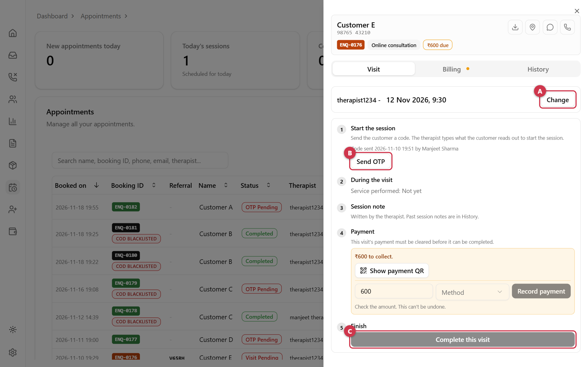

- **(A) Change:** changes the therapist, date or time.
- **(B) Send OTP:** sends the visit code again (same as task 9).
- **(C) Complete this visit:** **Admin only** (task 17).

2. On the **Visit** tab, click **Change** (A).

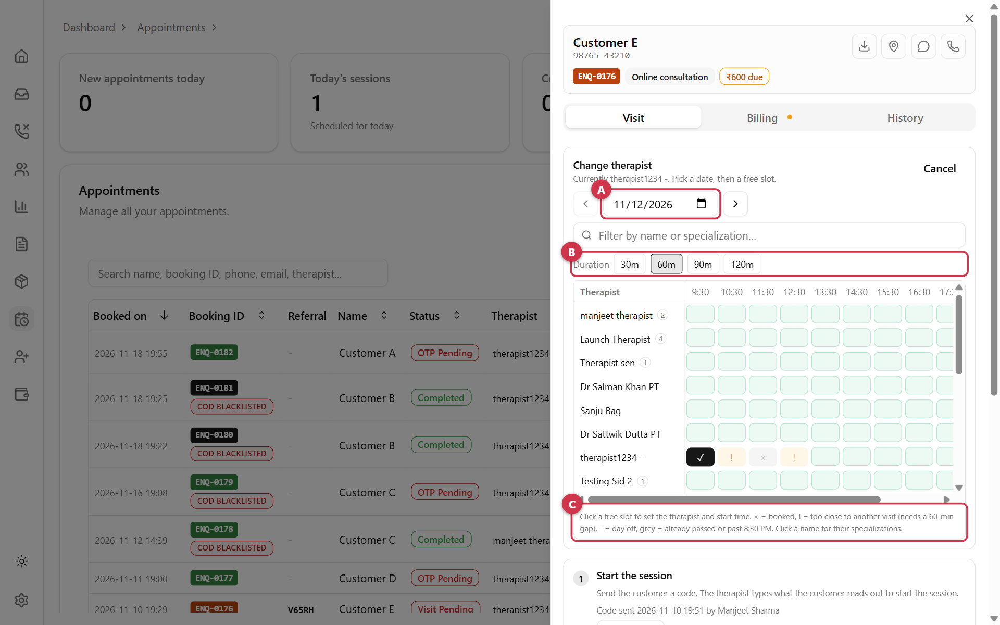

3. **Executives:** first select a reason in **Pick a reason**. Admins do not see this box.
4. Select the new date (A) and the visit length (B).
5. Click a free green box in the therapist's row. The line below (C) explains the marks. **The change saves as soon as you click.** You see the new therapist, date and time.

To stop without changing anything, click **Cancel** at the top of the box.

Good to know:

- After a change, tell the customer and the therapist.
- A completed visit cannot be moved.

### If something is not right

| Message | What to do |
|---|---|
| "Pick a reason for the reassignment" | Executives: select a reason first, then click the box again. |
| "... leaves less than the 60-min gap to .... Pick another time." | Select a time further from this therapist's other visit. |
| "This visit is done, so its therapist can't be changed." | The visit is completed. It cannot be moved. |

---

## 15. Cancel a booking

**When:** the customer does not want the visit any more.

1. Open the booking. Click the **History** tab.

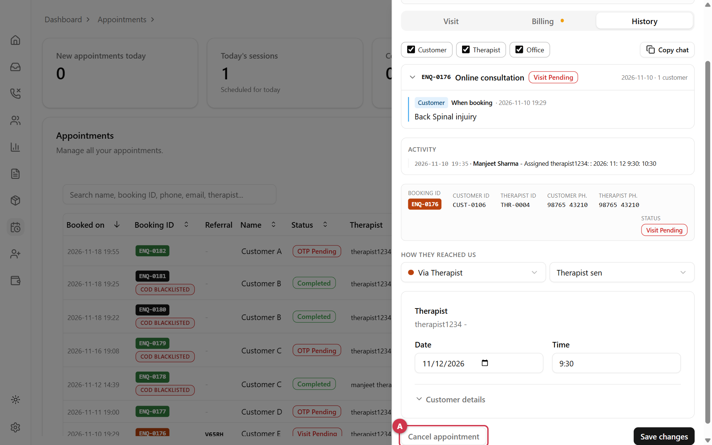

2. At the bottom, click **Cancel appointment** (A).
3. The app asks "Cancel this appointment?". Click **Cancel appointment**.

You see "Appointment cancelled".

Good to know:

- The app does not ask for a reason here. Write the reason in the customer's notes (Customers page) if it matters.
- A cancelled booking cannot be made active again from this screen. Ask an Admin.
- Tell the therapist.

---

## 16. Billing: ask for payment, offers, add-ons, invoice

Open the booking. Click the **Billing** tab.

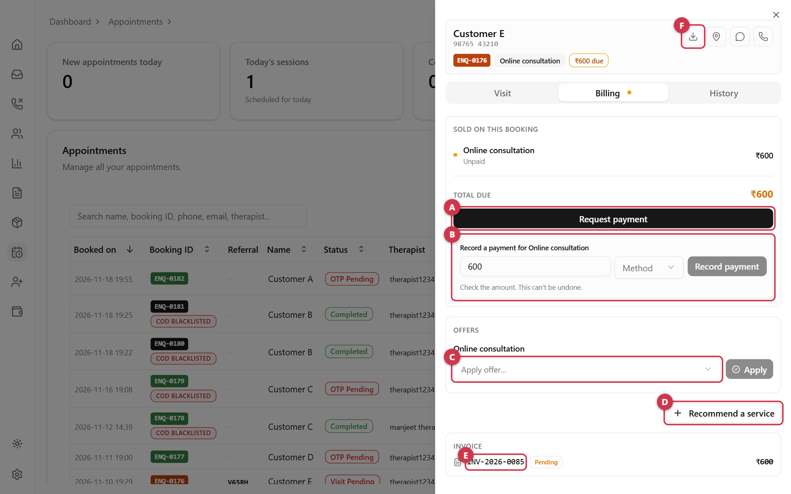

- **(A) Request payment:** WhatsApp opens with a payment link for the total due. Press send. The payment is not recorded by itself: record it when it comes (B).
- **(B) Record a payment:** enter the amount, select the method, click **Record payment**. **You cannot undo this.** After a payment, a **Send receipt** button shows. It sends the customer a WhatsApp receipt.
- **(C) Apply offer:** select an offer, then click **Apply**. The total due goes down.
- **(D) Recommend a service:** adds an extra service to this booking. It is the same form the therapist uses (therapist SOP, task 7).
- **(E) Invoice:** the invoice number and its status (Pending or Paid).
- **(F) Download:** downloads the invoice as a PDF.

### If something is not right

| Message | What to do |
|---|---|
| "Nothing is outstanding on this booking" | Everything is paid. There is nothing to ask for. |
| "This customer has no usable phone number" | Correct the phone number first. |
| "Your role can't apply this offer" | Ask an Admin to apply it. |
| "... Only an Admin or Super Admin can apply it again." | This customer already used this offer. Only an Admin can give it again. |

---

## 17. Complete a visit when the therapist could not

**Admin only.** Completing the visit is the therapist's job. Do this only when the therapist could not. Example: they forgot before leaving the customer's home.

The visit must already be started with the code, and the due payment must be paid.

1. Open the booking. On the **Visit** tab, click **Complete this visit** (C in task 14).
2. The app asks "Complete this visit for the therapist?". Click **Complete anyway**.

History shows that you completed it for the therapist.

### If something is not right

| Message | What to do |
|---|---|
| "Verify the visit OTP before checkout." | The session was never started with the code. Ask the therapist. |
| "Collect ₹X ... record it in Billing." | Record the payment first (task 16). |
