# MDW Wellness: Therapist SOP

This guide shows how to do your daily work in the MDW Wellness dashboard. Each part is one task.

- **Website:** https://dashboard.wellness.mydawaiwala.com
- **Screenshots** are from a phone. The customer names, phone numbers and addresses in them are not real.

## How to read this guide

- **Red circles with letters (A, B, C)** show a place on the screen. Below each picture, (A), (B) and so on tell you what that place is.
- **Numbers (1, 2, 3)** are the steps. Do them in order. A step shows its place with a letter. Example: "Tap **Verify** (C)."
- Inside a booking, the app also has grey numbers (1 Start the session, 2 During the visit, and so on). In this guide we write their names, not their numbers. Example: "the **Payment** step".

## Tasks

**A. Getting started**

1. Log in, log out, reset a forgotten password *(coming)*
2. Turn on phone alerts for new bookings *(coming)*

**B. A visit, from start to end**

3. [See today's visits and your bookings](#3-see-todays-visits-and-your-bookings)
4. [Open a booking](#4-open-a-booking)
5. [Start the visit with the customer's code](#5-start-the-visit-with-the-customers-code)
6. [During the session](#6-during-the-session)
7. [Suggest an add-on service](#7-suggest-an-add-on-service)
8. [Take the customer's payment](#8-take-the-customers-payment)
9. [Complete the visit](#9-complete-the-visit)

**C. Money, leave, profile**

10. [Check your earnings and cash in hand](#10-check-your-earnings-and-cash-in-hand)
11. [Mark your leave and weekly off days](#11-mark-your-leave-and-weekly-off-days)
12. [Update your profile and certificates](#12-update-your-profile-and-certificates)

---

## 3. See today's visits and your bookings

**When:** every morning, and any time you want to see your next visit.
**You see:** only your own bookings.

### 3.1 Your Dashboard

The Dashboard opens after you log in.

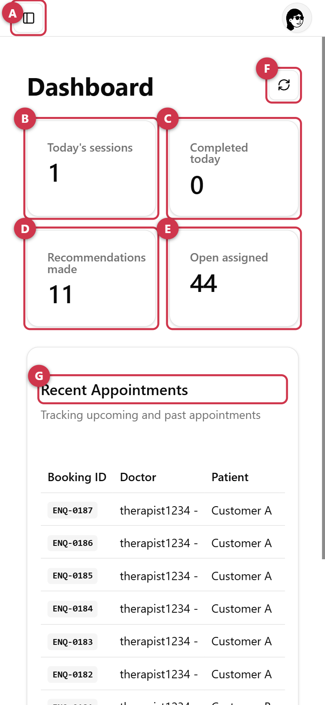

- **(A) Menu button:** opens the menu (Dashboard, Book Slot, Therapist List, Earnings).
- **(B) Today's sessions:** your visits for today.
- **(C) Completed today:** the visits you finished today.
- **(D) Recommendations made:** extra services you suggested to customers.
- **(E) Open assigned:** your bookings that are not finished.
- **(F) Refresh:** shows the latest numbers.
- **(G) Recent Appointments:** your latest bookings. The newest is on top.

### 3.2 Open your bookings list

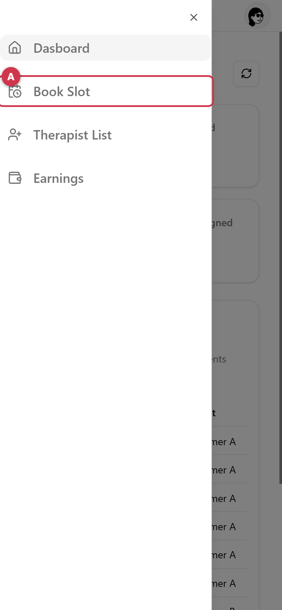

1. Tap the menu button. Then tap **Book Slot** (A). The page name is **Appointments**.

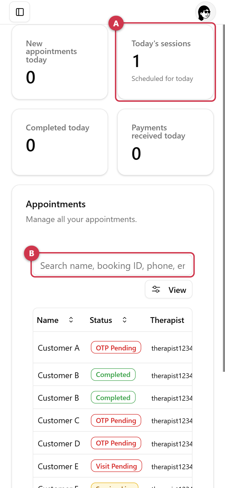

- **(A) Today's sessions:** how many visits you have today.
- **(B) Search:** type a customer name, a booking ID (example: ENQ-0182) or a phone number.

### 3.3 Read the status of each booking

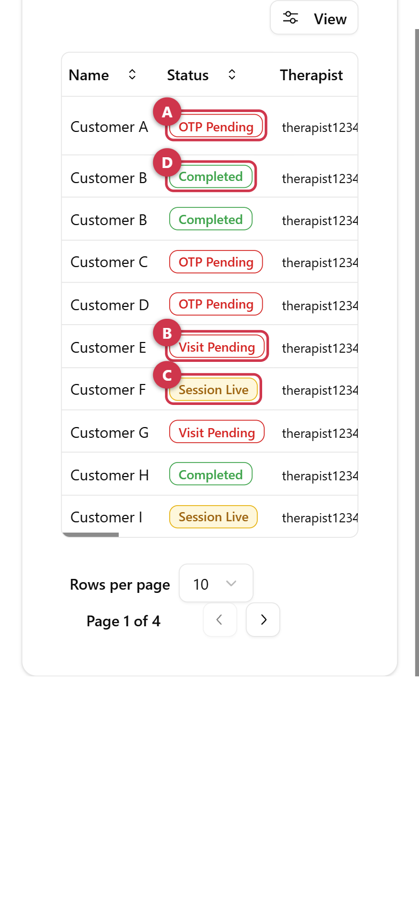

| Mark | Status | What it means | What you do |
|---|---|---|---|
| (A) | **OTP Pending** (red, blinking) | This booking is given to you. The office has not sent the visit code to the customer yet. | Nothing now. If the visit is soon, ask the office to send the code. |
| (B) | **Visit Pending** (red) | The office has sent the code to the customer. | At the visit, ask the customer for the 4-digit code. Enter it (task 5). |
| (C) | **Session Live** (yellow) | You entered the code. The session has started. | Tick the box and write the note (task 6). Take the payment (task 8). Then complete the visit (task 9). |
| (D) | **Completed** (green) | All visits of this booking are done. | Nothing. |

- **Cancelled** (dark red): the booking is cancelled. Do not go.
- **Courses (many sessions):** the status is for the next session that is not done. The **Sessions** column shows how many are done. Example: "1 of 6 completed".

### 3.4 Find your next visit

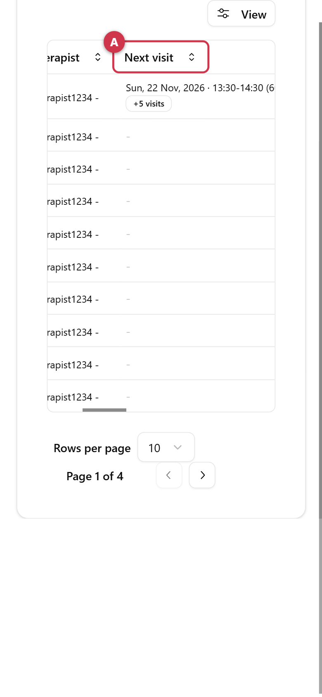

1. Move the table to the left with your finger. Stop when you see **Next visit** (A).
2. Tap the heading. Select **Asc**. The nearest visit comes to the top.

"+5 visits" below a date means 5 more sessions are booked after this one.

### If something is not right

- **The list is empty when the page opens:** wait a few seconds. It is still loading.
- **A booking is missing:** you only see bookings given to you. Ask the office.
- **The numbers look old:** tap Refresh on the Dashboard, or reload the page.

---

## 4. Open a booking

**When:** before you go to a visit. Check the address and the work.

### 4.1 Tap the booking

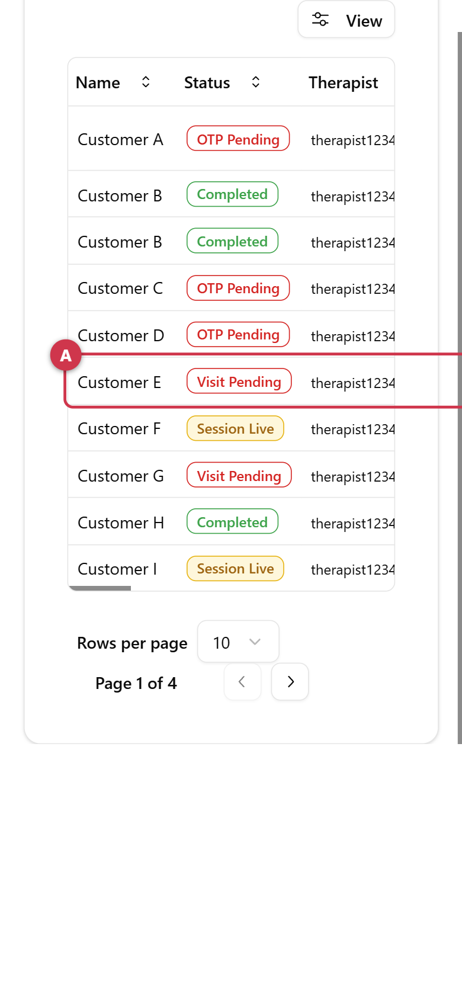

1. In **Book Slot**, tap the booking's row (A). The booking details open.

### 4.2 The top of the booking

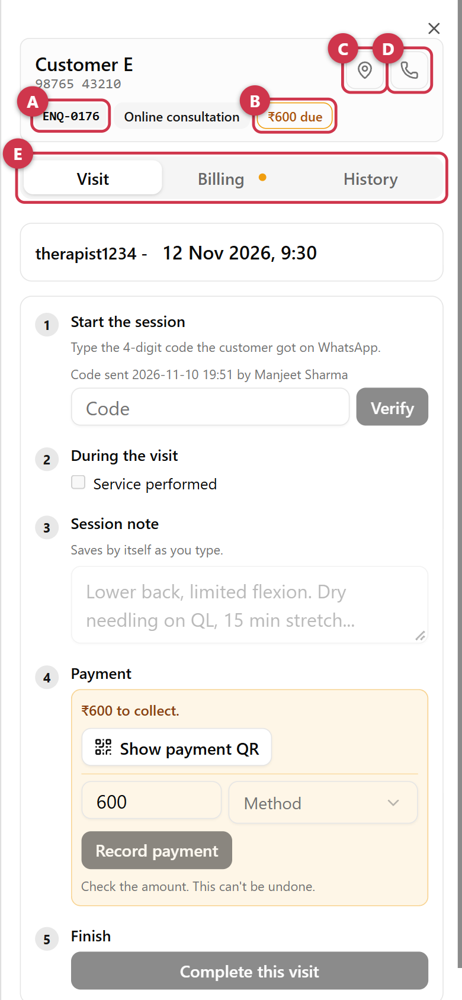

At the top you see the customer's name and phone number.

- **(A) Booking ID:** tell this ID to the office when you talk about this booking.
- **(B) Payment:** "₹600 due" means the customer must still pay. "Settled" or "Paid" means the money is received.
- **(C) Map pin:** shows the way to the customer's address.
- **(D) Phone:** calls the customer.
- **(E) Tabs:**
  - **Visit:** all the work you do at the visit. Tasks 5, 6, 8 and 9 are here.
  - **Billing:** the services in this booking. You suggest extra services here (task 7).
  - **History:** old notes and changes.

Below the tabs you see your name and the visit date and time.

### 4.3 Courses (many sessions)

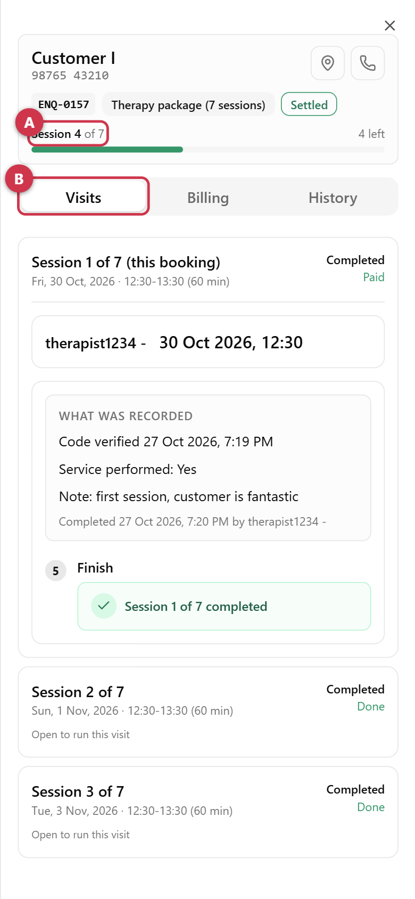

- **(A) Session 4 of 7:** the next session. The bar shows how many are done.
- **(B) Visits:** for a course, this tab shows all the sessions.

1. Open the **Visits** tab (B).
2. Tap the session you are doing now. Then do the same steps as a single visit.

### If something is not right

- **The address or phone number is wrong:** call the office. You cannot change customer details.
- **The date or time must change:** ask the office. Therapists cannot change it.

---

## 5. Start the visit with the customer's code

**When:** when you reach the customer's home.
**Before this:** the office sends the customer a 4-digit code on WhatsApp. The booking shows **Visit Pending**.

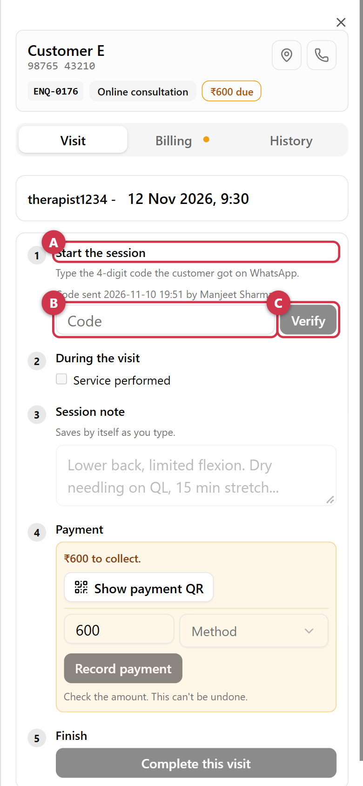

1. Open the booking. On the **Visit** tab, find the **Start the session** step (A).
2. Ask the customer to read the 4-digit code from WhatsApp. Type it in the **Code** box (B).
3. Tap **Verify** (C). You see "Session started". The status becomes **Session Live**.

Good to know:

- The code has no time limit. It works until it is used once.
- For a course, every session has its own code. After a session is completed, its code stops working. The office sends a new code for the next session.

### If something is not right

| Message | What to do |
|---|---|
| "No code yet - ask the office to send one." | Call the office. Ask them to send the code. |
| "Incorrect code." | Ask the customer to read the code again, slowly. |
| "Too many wrong codes - ask the office to send a new one." | After 5 wrong tries the code is blocked. Ask the office for a new code. |
| "This visit isn't assigned to you." | This is another therapist's visit. Ask the office. |

---

## 6. During the session

**When:** after the code is verified. Before that, these steps are grey and do not work.

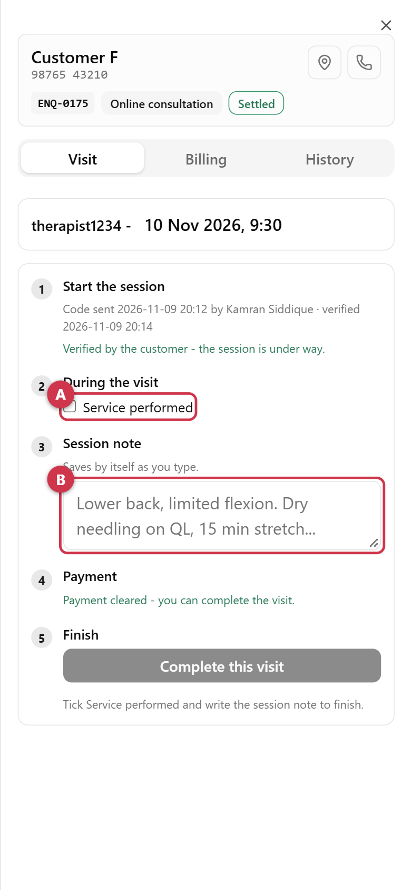

1. Do the treatment. Then tick **Service performed** (A).
2. In the **Session note** box (B), write what you found, your diagnosis and what you did. There is no Save button. The note saves by itself a few seconds after you stop typing.

Good to know:

- You must do both before you can complete the visit (task 9).
- Notes from old sessions are in the **History** tab.

---

## 7. Suggest an add-on service

**When:** during a visit, if the customer needs one more service. Example: an extra session.

### 7.1 Open the add-on form

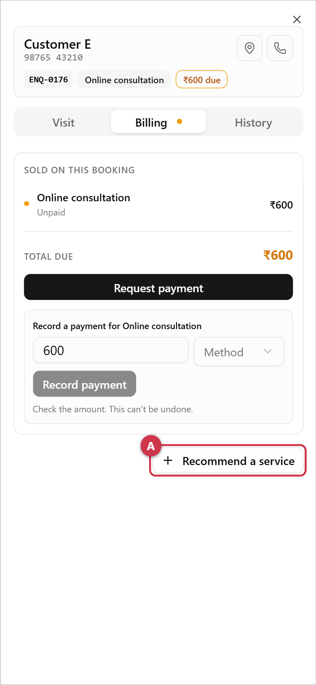

1. Open the **Billing** tab. Tap **Recommend a service** (A).

### 7.2 Fill the form

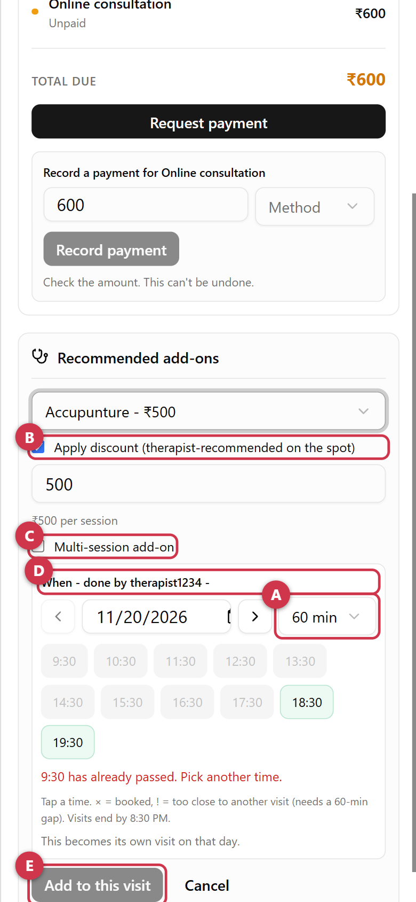

1. Select the service (A). The price comes from the price list.
2. **Apply discount** (B) is already ticked. It gives the customer a lower price for a service suggested at the visit. Untick it if you do not want to give the discount.
3. For more than one session, tick **Multi-session add-on** (C). Then enter the number of sessions and the days between them.
4. Under **When** (D), select the date and the session length. You will do this session yourself.
5. Tap a free time (E). × means booked. ! means too close to another visit. Visits must end by 8:30 PM.
6. Tap **Add to this visit** (F). You see "Add-on stacked on visit".

### 7.3 The customer agrees with a code

The add-on now shows **Awaiting customer**. It is not final until the customer agrees. *(Screenshot to come.)*

1. Tap **Send code**. WhatsApp opens with a message for the customer. It has the service, the price and a 4-digit code. Press send in WhatsApp.
2. Ask the customer for the code. Type it in **Code from customer**.
3. Tap **Confirm**. You see "Add-on confirmed".

### If something is not right

| Message | What to do |
|---|---|
| "Pick the date and time it will be done" | Select a date and tap a free time first. |
| "Send the customer a confirmation code first." | The code works for 15 minutes only. Tap **Send code** again. |
| "Incorrect code." | Ask the customer to read it again. |
| "This customer's number can't be messaged on WhatsApp" | Call the office. |

---

## 8. Take the customer's payment

**When:** during the visit. You cannot complete the visit until the money for it is paid.

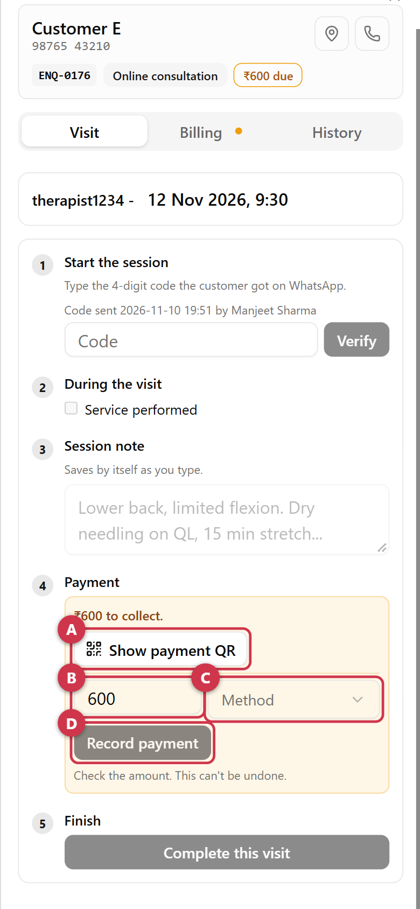

On the **Visit** tab, the **Payment** step shows the amount to collect. Example: "₹600 to collect."

- **(A) Show payment QR**
- **(B) Amount**
- **(C) Method:** Cash, UPI and others.
- **(D) Record payment**

**If the customer pays by UPI:**

1. Tap **Show payment QR** (A).
2. The customer scans the QR with any UPI app. The amount is already filled.
3. Wait until the customer shows you that the payment is successful.
4. Check the amount (B). Select **UPI** (C). Tap **Record payment** (D).

**If the customer pays cash:**

1. Check the amount (B).
2. Select **Cash** (C).
3. Tap **Record payment** (D).

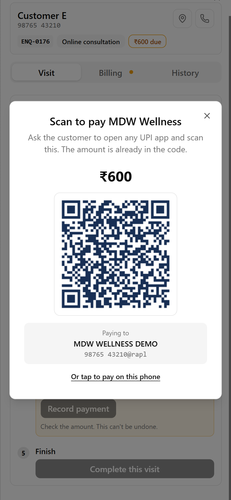

The QR screen shows the amount and the company name. If the customer pays from their own phone, they can tap **Or tap to pay on this phone**.

Good to know:

- **You cannot undo a recorded payment.** Check the amount before you tap Record payment.
- Scanning the QR does not record the payment. You must still tap **Record payment**.
- Cash you take is company money. It is cut from your payment. You see it on the Earnings page as "Cash you collected".
- For a course, each session must be paid for before it starts. Example: before session 3 of 9, at least 3/9 of the full price must be paid.
- Payment for an add-on is recorded in the **Billing** tab, on the add-on's line.

### If something is not right

| Message or problem | What to do |
|---|---|
| Cash shows "Cash (COD blacklisted)" and you cannot select it | The office has stopped cash for this customer. Take UPI with the QR. |
| "Only ₹X is due on this booking." | You entered more than the due amount. Enter the correct amount. |
| "Another payment was just recorded - refresh and try again." | Someone else recorded a payment at the same time. Close the booking. Open it again and check the due amount. |

---

## 9. Complete the visit

**When:** at the end of the visit, after the payment.

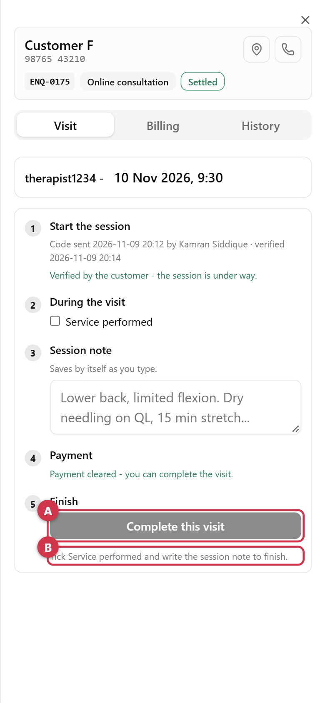

1. Tap **Complete this visit** (A). For a course it says **Complete session 3 of 7** (with your session number).
2. If the button is grey, read the line below it (B). It tells you what is missing.

The button works only when all four are done:

- the code is verified (task 5)
- **Service performed** is ticked (task 6)
- the session note is written (task 6)
- the due payment is paid (task 8)

When it works you see "Visit completed", "Session 3 of 7 completed" or "Package complete".

### If something is not right

| Line below the button (B) | What to do |
|---|---|
| "Collect ₹X to finish." | Take the payment first (task 8). |
| "Write the session note to finish." | Write the note (task 6). |
| "Tick Service performed and write the session note to finish." | Do both (task 6). |

---

## 10. Check your earnings and cash in hand

**When:** any time you want to see your earnings. Also before you give cash to the office or take your payment.

Open the menu. Tap **Earnings**. The page name is **My Earnings**.

### 10.1 Who pays whom

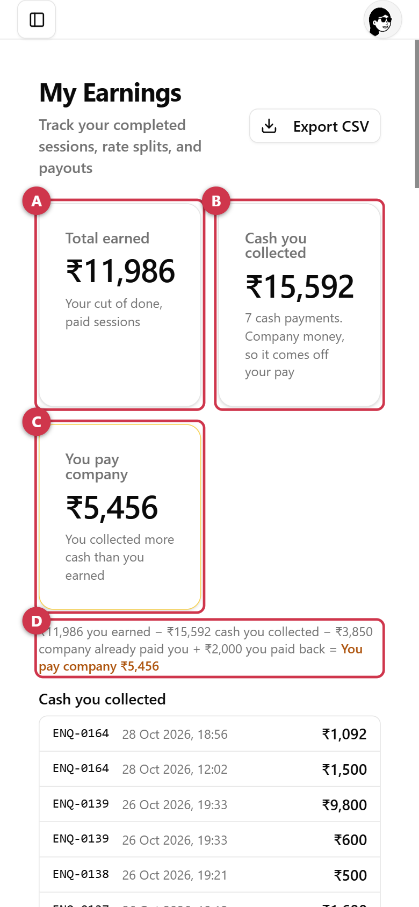

- **(A) Total earned:** your share from sessions that are done and paid.
- **(B) Cash you collected:** cash that customers gave you. This is company money, so it is cut from your payment.
- **(C) Who pays whom:** you see one of these:
  - **Company pays you ₹X:** the company must still pay you this amount.
  - **You pay company ₹X:** you have more company cash than you earned. Give this amount to the office.
  - **All settled:** nobody needs to pay anything.
- **(D) The calculation:** what you earned, minus cash you collected, minus what the company already paid you, plus what you paid back.

These four boxes always show all time. The dates you select lower on the page do not change them.

### 10.2 Your cash list and totals

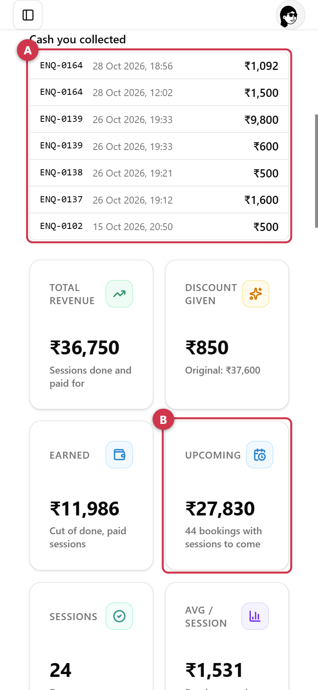

- **(A) Cash you collected:** every cash payment, with booking ID, date, time and amount. Check it with the cash you really took.
- **(B) Upcoming:** your share from sessions that are booked but not done yet.

Other boxes: **Total revenue** is what customers paid for your sessions. **Earned** is your share. **Sessions** is how many sessions you completed.

### 10.3 See one period

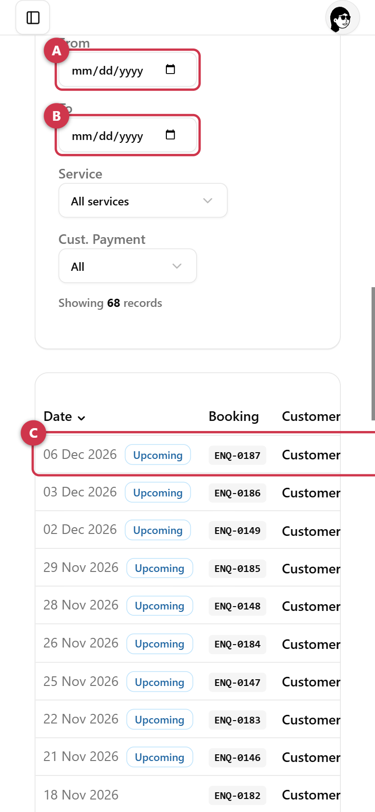

1. Select the first day in **From** (A) and the last day in **To** (B). Example: one month. The cash list, the boxes and the table now show only that period.
2. Each row (C) is one session: date, booking ID, customer, payment and your share. Move the table to the left to see more columns.

To save a copy, tap **Export CSV** at the top. It downloads a file you can open in Excel.

Good to know:

- A session counts only when it is done and the customer has paid.
- When you give cash to the office, or the office pays you, the office records it. Then you see it in (D).

### If something is not right

- **The boxes show ₹0 when the page opens:** wait a few seconds. It is still loading.
- **A cash payment is missing or wrong:** tell the office the booking ID.

---

## 11. Mark your leave and weekly off days

**When:** as soon as you know you will be on leave. Also when your weekly off day changes.

No approval is needed. Leave starts working as soon as you add it. Also inform the office.

### 11.1 Open your availability

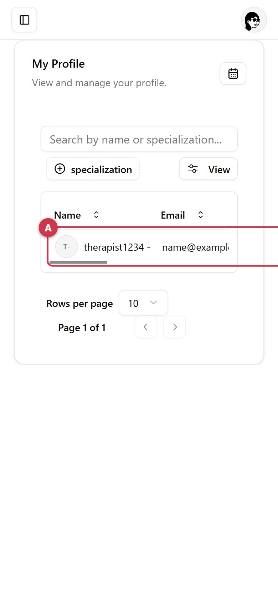

1. Open the menu. Tap **Therapist List**. The page name is **My Profile**.
2. Tap your row (A).

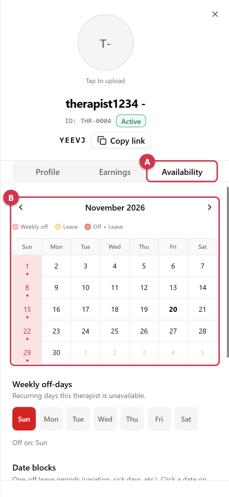

3. Open the **Availability** tab (A).

The calendar (B) shows the month. Red days are weekly off days. Yellow days are leave. Use the arrows to see another month.

### 11.2 Set off days and leave

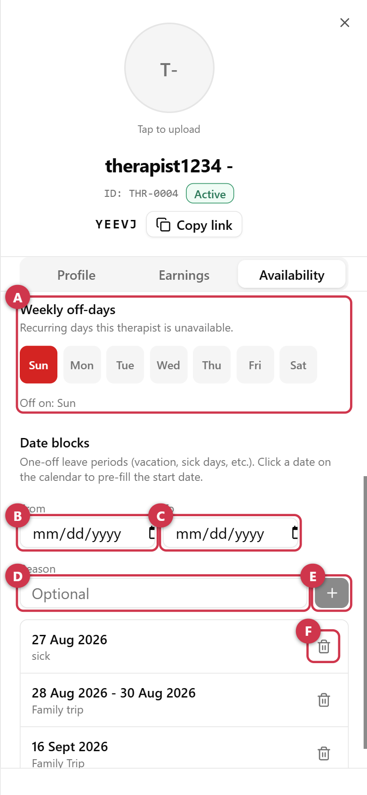

**Weekly off days (A):** tap a day to make it off or on. Red means off. It saves by itself. You see "Weekly schedule updated".

**Leave on some dates:**

1. Select the first day in **From** (B). You can also tap that day on the calendar.
2. Select the last day in **To** (C). For one day of leave, keep it empty.
3. Write a reason (D) if you want. It is not required.
4. Tap **+** (E). You see "Leave added". The leave shows in the list below.

To cancel a leave, tap the bin (F) on its line. It is removed at once. The app does not ask "are you sure?".

Good to know:

- The office cannot book you on your off days or leave days. The system stops them.
- Bookings you **already have** on those days do not change. Ask the office to move them.

---

## 12. Update your profile and certificates

**When:** when your details change, or you get a new certificate.

Open **My Profile** like in task 11 (menu, **Therapist List**, your row). The **Profile** tab opens first.

### 12.1 Photo, referral link and details

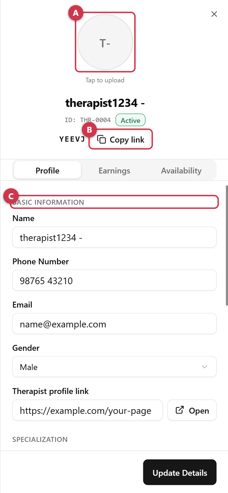

- **(A) Photo:** tap it to choose a new photo.
- **(B) Copy link:** copies your referral link. Bookings made with this link are counted as yours. The code next to it is your referral code.
- **(C) Basic information:** name, phone number, email, gender and your profile page link.

### 12.2 Specialization, bio and certificates

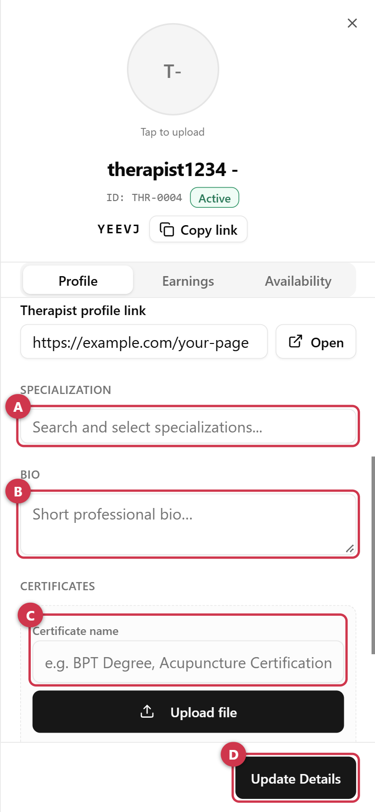

1. Change what you need:
   - **Specialization** (A): type and select the therapies you do.
   - **Bio** (B): a few lines about you.
2. To add a certificate: type its name in **Certificate name** (C). Example: "BPT Degree". Then tap **Upload file** and select the photo or PDF. You see "Certificate added".
3. Tap **Update Details** (D). You see "Therapist updated successfully".

**Nothing on the Profile tab is saved until you tap Update Details** (D). This includes a new photo or certificate. Off days and leave (task 11) save by themselves.

Good to know:

- If you change your phone number or email here, your login does not change. To change your login, ask the office.
- You cannot make your own profile Not Active. Ask the office.

### If something is not right

| Message | What to do |
|---|---|
| "Write the certificate name first (e.g. BPT Degree)" | Type the name. Then tap Upload file again. |
| "Upload failed: ..." | Check the file size: up to 8 MB for a photo, 16 MB for a PDF. Then try again. |
| "Name is required." | The Name box cannot be empty. |
